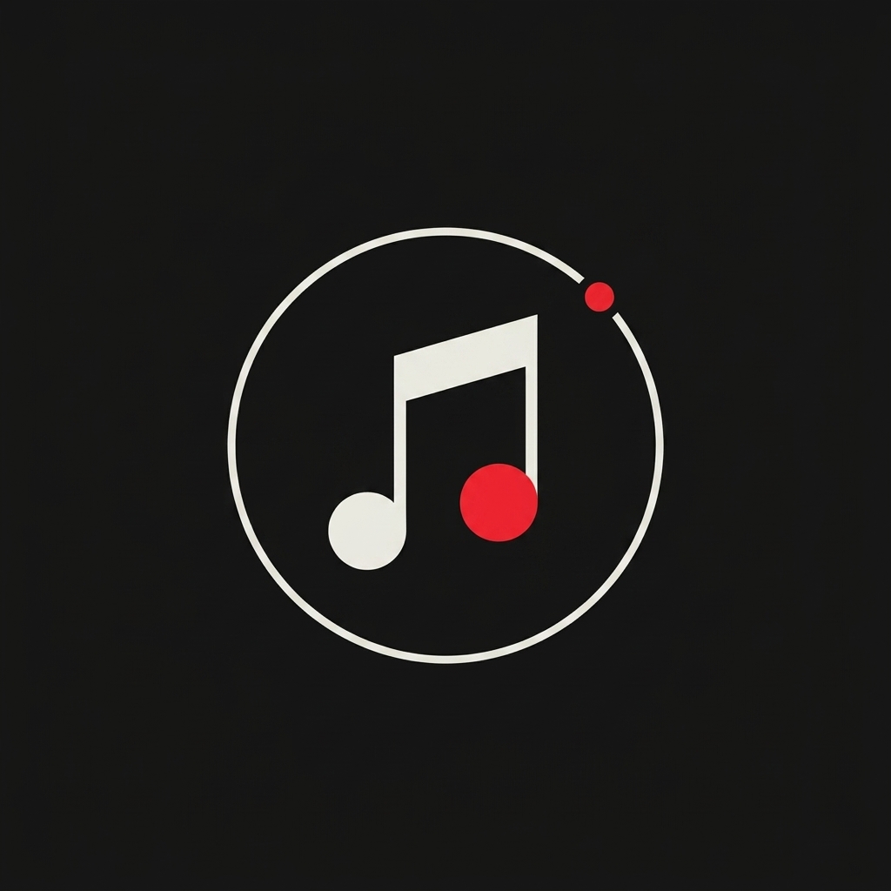
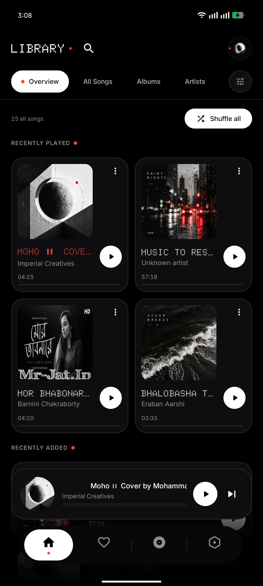
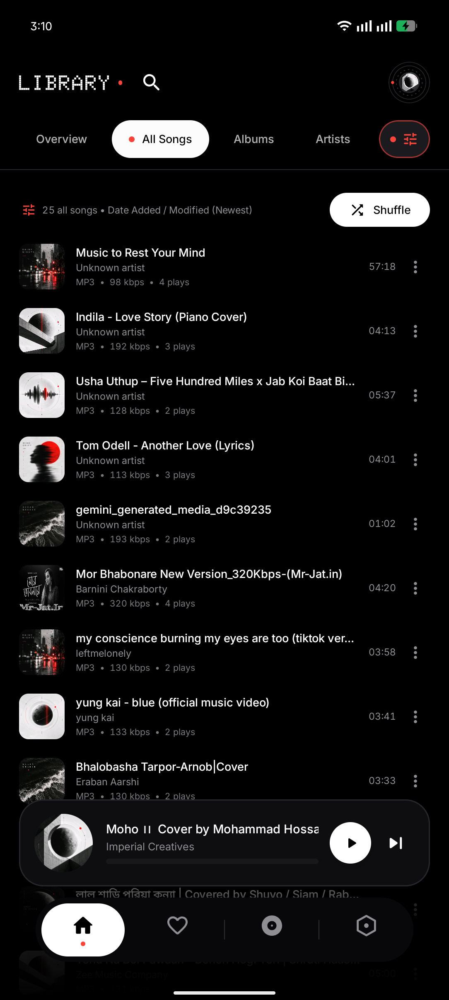
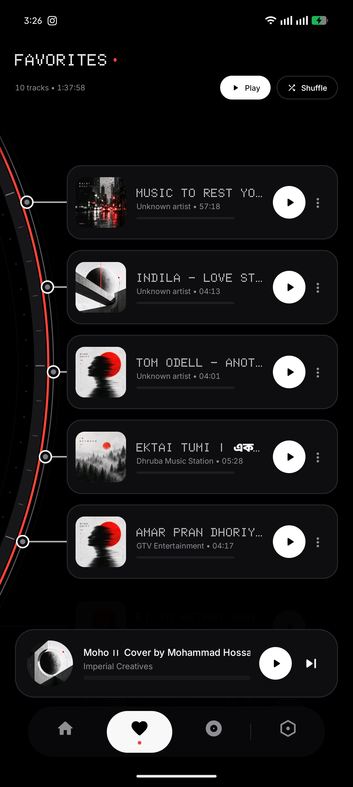
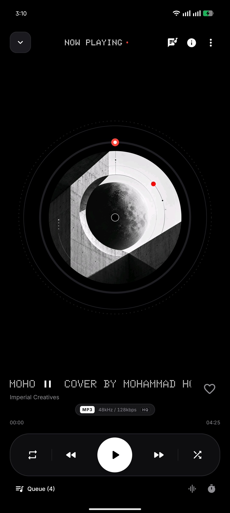
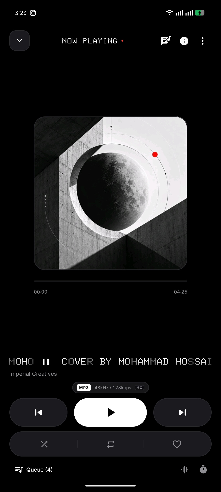
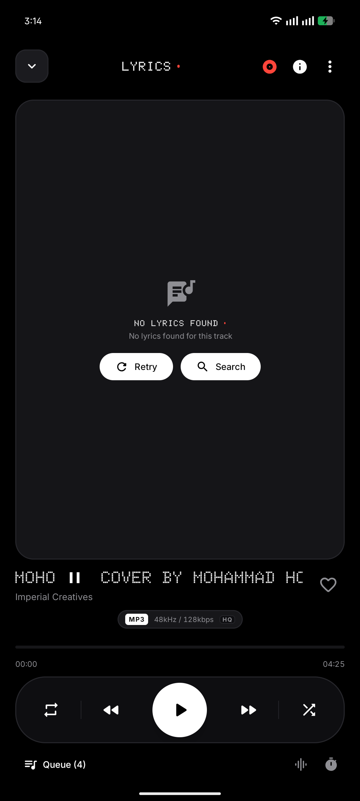

# Orbit Apps Hub 🪐
### Official Releases & Direct APK Downloads by Fahim Takrim

  Welcome to the official distribution hub for the <b>Orbit Ecosystem</b>. Handcrafted Android applications engineered with a distinctive <b>Nothing OS & Bauhaus aesthetic</b>, uncompromising privacy, and fluid performance by <b><a href="https://x.com/TakrimFahim">Fahim Takrim</a></b>.

### 📲 [Browse All Releases](https://github.com/fahitakrim/my-artifacts/releases) · [Orbit Music APK (v3.6.3)](https://github.com/fahitakrim/my-artifacts/releases/download/v3.6.3/Orbit-Music-v3.6.3.apk) · [Orbit Board APK (v1.3.9)](https://github.com/fahitakrim/Orbit-Board/releases/tag/v1.3.9) · [Orbitwall APK (v1.1.5)](https://github.com/fahitakrim/my-artifacts/releases/download/orbitwall-latest/Orbitwall.apk)

---

## ⚡ Direct Downloads (Quick Hub)

| Application | Category | Latest Version | Direct Download | Release Notes |
| :--- | :--- | :---: | :---: | :---: |
| 🎵 **Orbit Music** | Minimalist Offline Music Player | `v3.6.3` Stable | [⬇️ Download APK (12.2 MB)](https://github.com/fahitakrim/my-artifacts/releases/download/v3.6.3/Orbit-Music-v3.6.3.apk) | [v3.6.3 Notes](https://github.com/fahitakrim/my-artifacts/releases/tag/v3.6.3) |
| ⌨️ **Orbit Board** | Nothing OS Keyboard & Bengali Layouts | `v1.3.9` Stable | [⬇️ Download APK (24 MB)](https://github.com/fahitakrim/Orbit-Board/releases/tag/v1.3.9) | [v1.3.9 Notes](https://github.com/fahitakrim/Orbit-Board/releases/tag/v1.3.9) |
| 🪐 **Orbitwall** | 4K Wallpaper & Lockscreen Clocks | `v1.1.5` Latest | [⬇️ Download APK (2.8 MB)](https://github.com/fahitakrim/my-artifacts/releases/download/orbitwall-latest/Orbitwall.apk) | [v1.1.5 Notes](https://github.com/fahitakrim/my-artifacts/releases/tag/v1.1.5) |

---

## 📑 Table of Contents
- [1. Orbit Music — Offline Android Music Player](#1-orbit-music--offline-android-music-player)
  - [✨ Key Features](#-key-features-orbit-music-v363)
  - [📸 Screenshots Showcase](#-orbit-music-screenshots)
  - [🎵 Supported Audio Formats](#-supported-audio-formats)
  - [📥 Download Orbit Music APK](#-download-orbit-music-apk)
- [2. Orbit Board — Private Nothing OS Keyboard](#2-orbit-board--private-nothing-os-keyboard)
  - [✨ Key Features](#-key-features-orbit-board-v139)
  - [📥 Download Orbit Board APK](#-download-orbit-board-apk)
- [3. Orbitwall — 4K Nothing OS Wallpaper App](#3-orbitwall--4k-nothing-os-wallpaper-app)
- [Frequently Asked Questions (FAQ)](#-frequently-asked-questions-faq)
- [Developer & Contact](#-developer--contact)

---

## 1. Orbit Music — Offline Android Music Player

> **Orbit Music** is a sleek, privacy-first **offline Android music player** designed with a **Nothing OS & Bauhaus visual identity**. Featuring tactile jog-wheel interactions, a dynamic curved **ArcTimeline**, **real-time synced lyrics (LRCLIB)**, and high-fidelity bit-perfect audio playback.

[-3DDC84?style=flat-square&logo=android)](https://github.com/fahitakrim/my-artifacts/releases/tag/v3.6.3)

### ✨ Key Features (Orbit Music v3.6.3)
* 📱 **Pixel-Style & Glance Widgets:** Handcrafted Classic Card (4x2), 2x2 Quadrant, and 4x1 Minimal Bar home screen widgets with Material You dynamic color extraction and lockscreen support.
* ⚡ **Ultra-Responsive Player Gestures:** Fluid swipe-up and swipe-down gestures on MiniPlayer and Now Playing screen with tuned flick sensitivity.
* 🪐 **Curved ArcTimeline Wheel:** Smooth 120Hz rotating hardware dial with tactile haptic feedback and dynamic orbital nodes.
* 🎨 **Dual Player Themes (Circle vs Boxy):** Toggle between a tactile turntable jog-wheel SeekDial and a modern Nothing OS squircle card.
* 🎤 **Synchronized Lyrics (LRCLIB & Local LRC):** Real-time line-by-line scrolling lyrics, tap-to-seek, and live calibration toolbar (`[-0.5s]` / `[+0.5s]`).
* 🎛️ **Floating 5-Band Equalizer:** Precision tuning (60Hz to 14kHz), bass boost, and 3D virtualizer surround sound.
* 📊 **High-Res Audio Specs & Inspector:** Automatic `[HD]` / `[HI-RES]` badges for 24-bit/192kHz tracks with exact bit depth and bitrate metadata.
* 🔒 **Zero Ads & Total Privacy:** No account needed, zero tracking, and no background internet drain for playback.

### 📸 Orbit Music Screenshots

| Library Overview | All Songs & Specs | Favorites ArcTimeline |
|:---:|:---:|:---:|
|  |  |  |

| Circle Jog-Wheel Player | Boxy Minimalist Player | Synced Lyrics Hero |
|:---:|:---:|:---:|
|  |  |  |

### 🎵 Supported Audio Formats
* **Lossless:** FLAC (up to 24-bit/192kHz), WAV (PCM 16/24/32-bit), ALAC (Apple Lossless).
* **Compressed:** MP3 (up to 320kbps CBR/VBR), AAC, M4A, Opus, OGG Vorbis.

### 📥 Download Orbit Music APK
* **Direct Official APK:** [Orbit-Music-v3.6.3.apk (12.2 MB)](https://github.com/fahitakrim/my-artifacts/releases/download/v3.6.3/Orbit-Music-v3.6.3.apk)
* **Release Notes & Changelog:** [Orbit Music v3.6.3 Stable Release](https://github.com/fahitakrim/my-artifacts/releases/tag/v3.6.3)

---

## 2. Orbit Board — Private Nothing OS Keyboard

> *A private, minimal Android keyboard crafted specifically with a Nothing OS aesthetic and complete Bengali layout support (Avro, Jatiyo, Probhat, Bangla).*

### ✨ Key Features (Orbit Board v1.3.9)
* 🌌 **Constellation Web Typing Effect:** Cyber threads and glowing Nothing Red nodes under active keystrokes.
* 🫧 **Calibrated Bubble Burst Particles:** 20 tuned Bauhaus micro-dots for clean tactile feedback.
* 🇧🇩 **Full Bengali Layout Suite:** Avro Phonetic, Probhat with `[ ্য | য | র্য ]` ergonomic popup, Jatiyo Modern, Jatiyo Classic, and Alphabetical Bangla.
* 🔢 **Instant Bengali Number Pad Switcher:** Dialpad shortcut key (`১২৩` / `123`) to toggle instantly between English and Bengali numbers.
* 📐 **Interactive Real-Time Resizer:** Live visual feedback while adjusting keyboard height and bottom padding.
* 🎙️ **Private Voice Typing:** Fast on-device voice typing with dedicated audio mute click toggle.
* 🔒 **Zero Telemetry:** 100% on-device processing. No keystroke logging, zero network permissions.

### 📥 Download Orbit Board APK
* **ARM64-v8a Direct APK:** [Orbit-Board-v1.3.9-arm64-release.apk](https://github.com/fahitakrim/Orbit-Board/releases/download/v1.3.9/Orbit-Board-v1.3.9-arm64-release.apk) *(Recommended)*
* **Universal Direct APK:** [Orbit-Board-v1.3.9-universal-release.apk](https://github.com/fahitakrim/Orbit-Board/releases/download/v1.3.9/Orbit-Board-v1.3.9-universal-release.apk)
* **GitHub Release Page:** [Orbit Board v1.3.9 Release](https://github.com/fahitakrim/Orbit-Board/releases/tag/v1.3.9)

---

## 3. Orbitwall — 4K Nothing OS Wallpaper App

> *A minimalist, high-performance 4K wallpaper application crafted with an authentic Nothing OS visual identity, Dot-Matrix typography, and live lock screen clock preview faces.*

### ✨ Key Features (v1.1.5)
* ☁️ **Global Cloud Sync:** Curated picks, welcome showcase, and rankings synced dynamically via GitHub edge.
* 🌌 **125+ Handcrafted Wallpapers:** Remastered 2K/4K AMOLED, Anime, Minimal, and Bauhaus collections.
* ⏰ **Interactive Lock Screen Clocks:** 4 customizable ambient clock dials with real-time tap-to-switch preview.
* 🔴 **Nothing OS Design Identity:** Pure monochrome palette, `#E51C23` red accents, and authentic Dot-Matrix typography.

### 📥 Download Orbitwall APK
* **Direct Download:** [Orbitwall.apk](https://github.com/fahitakrim/my-artifacts/releases/download/orbitwall-latest/Orbitwall.apk)
* **v1.1.5 Release Notes:** [Orbitwall v1.1.5 Release](https://github.com/fahitakrim/my-artifacts/releases/tag/v1.1.5)

---

## ❓ Frequently Asked Questions (FAQ)

<b>1. How do I install the APK on my Android phone?</b>

Download the <code>.apk</code> file from the download buttons above, open it on your device, and allow <i>"Install from Unknown Sources"</i> when prompted by your browser or file manager.

<b>2. Is Orbit Music completely free and offline?</b>

Yes. Orbit Music is 100% free with no ads, no subscriptions, and requires zero account login. It plays all your local audio files directly from your device storage.

<b>3. Does Orbit Music support high-resolution (Hi-Res) audio?</b>

Yes. Orbit Music natively decodes lossless audio up to 24-bit/192kHz (FLAC, WAV, ALAC) with dynamic Hi-Res badge indicators and 5-band equalizer processing.

<b>4. How do Orbit apps update?</b>

Orbit Music and Orbit Board come with built-in non-intrusive update checkers that notify you whenever a new release is published right here on GitHub.

---

## 👨‍💻 Developer & Contact

Created with passion by **Fahim Takrim**.

* **X (Twitter):** [@TakrimFahim](https://x.com/TakrimFahim)
* **GitHub:** [@fahitakrim](https://github.com/fahitakrim)
* **Facebook:** [Fahim Takrim Profile](https://www.facebook.com/profile.php?id=61592810150809)

If you enjoy Orbit Music, Orbit Board, or Orbitwall, please consider giving this repository a ⭐ on GitHub!

---

## 🔒 Security & Verification
All APKs released in this repository are compiled directly from source and digitally signed. They contain no tracking libraries, telemetry, or hidden payloads.
