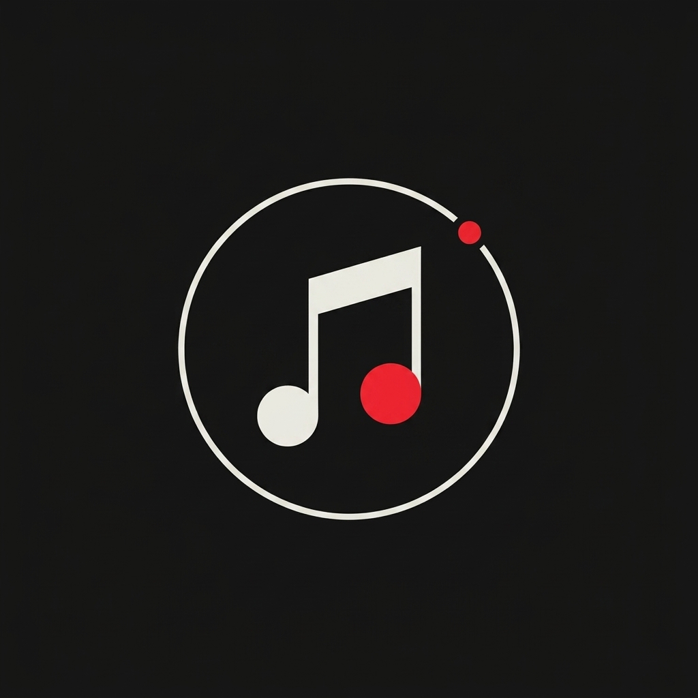

# Orbit Music — Logo & Brand Icon (v3.6.2) 🪐

Brand visual identity and launcher icon specification for **Orbit Music v3.6.2**.

## 🎨 Asset Previews

| Dark / AMOLED Edition (Primary Launcher) | Light / Minimalist Edition (Monochrome/Splash) |
| :---: | :---: |
|  |  |

---

## 💡 Design Breakdown

1. **The Orbit Ring:** Single continuous circular path capturing the astronomical "Orbit" theme.
2. **The Red Satellite Dot:** Signature Nothing OS accent dot positioned at ~1 o'clock.
3. **The Bauhaus Note:** Sharp, architectural geometry with angled beam.
4. **Two-Tone Heads:** Left head maintains monochromatic contrast (White in Dark, Black in Light), while the right head pops in Nothing Red (`#E5252A`) indicating live playback and rhythm.

---

## 🎨 Color Palette

- Dark Background: `#121212`
- Light Background: `#EAE8E1`
- Off-White Tone: `#F0EFEB`
- Charcoal Slate: `#1B1B1B`
- Nothing Red Accent: `#E5252A`
